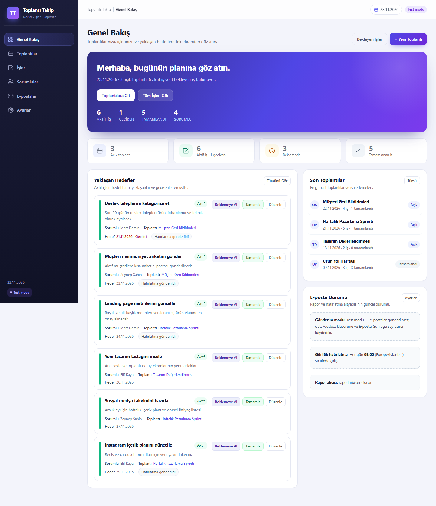
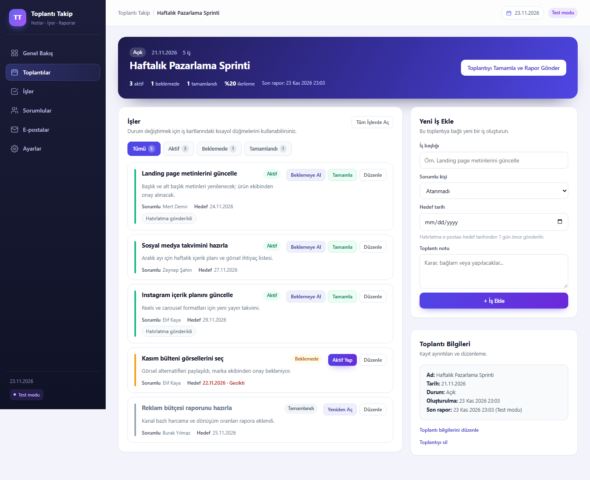
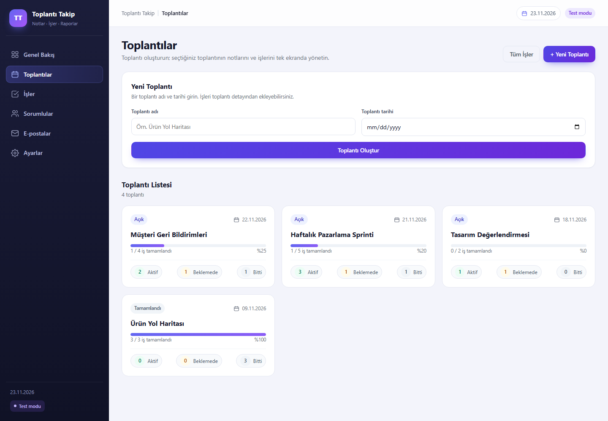
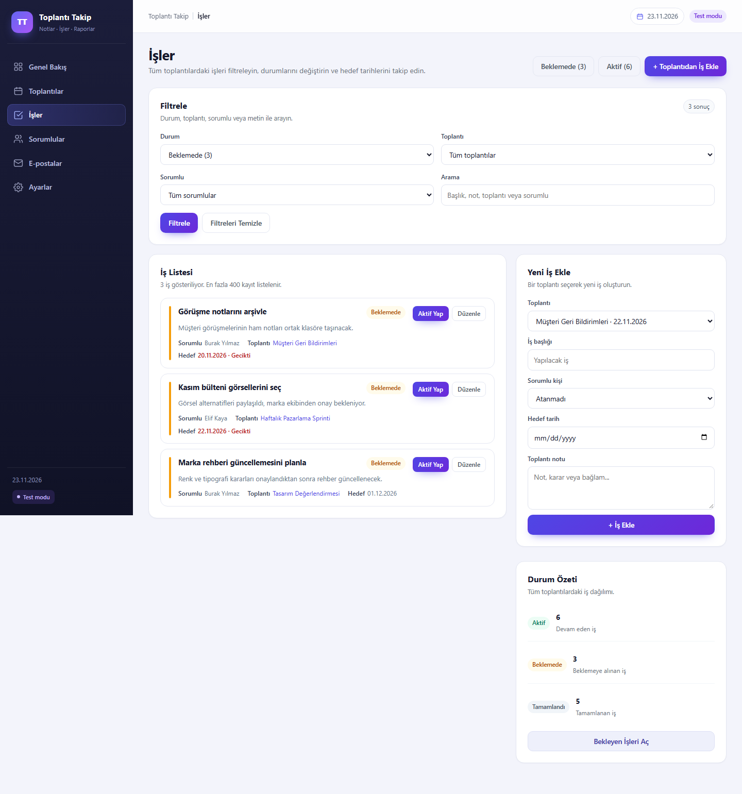
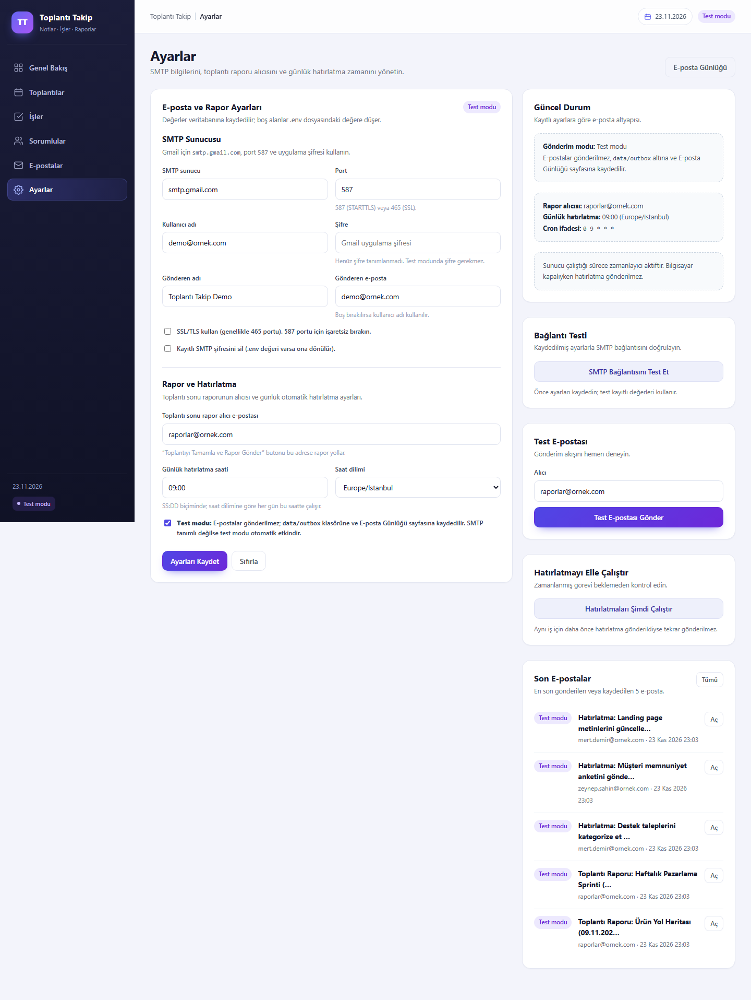
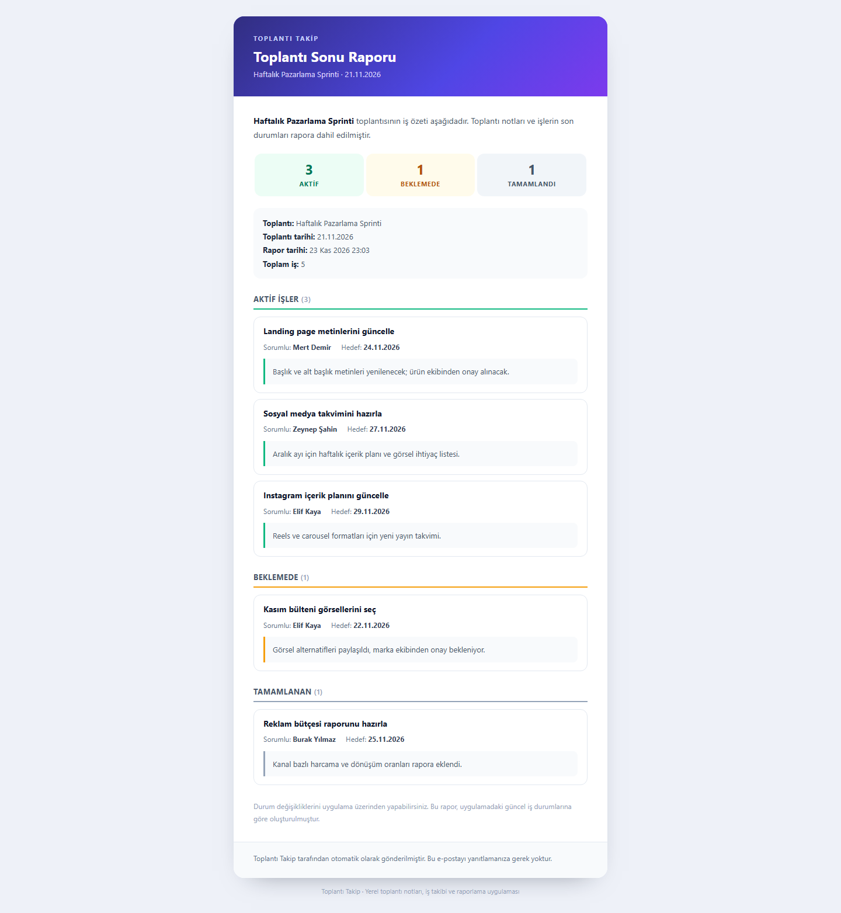

# Toplantı Takip

Yerel bilgisayarda çalışan, verileri SQLite veritabanında saklayan Türkçe arayüzlü bir **toplantı notları ve iş takip** uygulaması.

Toplantı oluşturup işleri sorumlulara atayabilir, hedef tarihleri takip edebilir, işleri **Aktif / Beklemede / Tamamlandı** durumları arasında tek tıkla taşıyabilirsiniz. Toplantı sonunda şık bir HTML raporu e-posta ile gönderebilir, her gün belirlenen saatte yaklaşan işler için sorumlulara otomatik hatırlatma yaptırabilirsiniz.

## Özellikler

- **Sorumlu yönetimi:** Ad ve e-posta ile kişi ekleme, düzenleme, silme.
- **Toplantı yönetimi:** Toplantı adı ve tarihiyle kayıt oluşturma; toplantıya ait güncel işleri tek ekranda listeleme.
- **İş takibi:** Toplantı içine iş ekleme; sorumlu, hedef tarih ve toplantı notu belirleme.
- **Durum yönetimi:** `Aktif`, `Beklemede`, `Tamamlandı` durumları; “Beklemede” sekmesinden tek tıkla `Aktif` durumuna döndürme.
- **Toplantı sonu raporu:** “Toplantıyı Tamamla ve Rapor Gönder” butonu; notları ve aktif/bekleyen/tamamlanan işleri özetleyen HTML raporunu tanımlı alıcıya gönderir.
- **Otomatik hatırlatma:** `node-cron` ile her gün belirlenen saatte; durumu `Aktif` olan ve hedef tarihine 1 gün kalmış, bugünü gelmiş veya gecikmiş işler için sorumluya e-posta gönderir.
- **Mükerrer gönderim koruması:** Her işte `hatirlatma_gonderildi` alanı tutulur; aynı iş için tekrar hatırlatma gönderilmez.
- **Test modu:** SMTP tanımlı değilken veya test modu açıkken e-postalar gönderilmez; `data/outbox` klasörüne HTML olarak kaydedilir ve E-posta Günlüğü sayfasından görüntülenebilir.
- **Türkçe arayüz:** Duyarlı tasarım, durum renkleri, tablolar ve boş durum ekranları.
- **Otomatik testler:** Sahte SMTP sunucusuyla gerçek Nodemailer gönderim yolu, hatırlatma kuralları, mükerrer gönderim, form akışları ve HTML kaçışları test edilir.

## Ekran Görüntüleri

| Genel Bakış | Toplantı Detayı |
| --- | --- |
|  |  |

| Toplantılar | İşler / Beklemede |
| --- | --- |
|  |  |

| Ayarlar | Toplantı Raporu (E-posta) |
| --- | --- |
|  |  |

## Teknolojiler

| Katman | Teknoloji |
| --- | --- |
| Sunucu | Node.js, Express 5 |
| Arayüz | EJS sunucu taraflı şablonlar, saf CSS/JS |
| Veritabanı | SQLite (`node:sqlite`, ek native derleme gerekmez) |
| E-posta | Nodemailer |
| Zamanlayıcı | node-cron |
| Test | Node.js yerleşik `node:test`, sahte SMTP sunucusu |

## Gereksinimler

- **Node.js 24 veya üzeri** (Node 26 ile test edildi)
- npm
- E-posta göndermek için bir SMTP hesabı (ör. Gmail uygulama şifresi). Test modunda SMTP gerekmez.

> `node:sqlite` Node.js 22.5 ile deneysel olarak geldi; bu proje Node 24+ hedefler. Node sürümünüzü `node --version` ile kontrol edin.

## Kurulum

```bash
git clone https://github.com/emr3ks/toplanti-takip.git
cd toplanti-takip
npm install
```

Windows CMD/PowerShell:

```powershell
copy .env.example .env
```

macOS/Linux:

```bash
cp .env.example .env
```

`.env` dosyasını düzenleyebilir veya tüm ayarları uygulamadaki **Ayarlar** sayfasından girebilirsiniz. Arayüzde doldurulan değerler veritabanına yazılır; boş alanlar `.env` değerine, o da yoksa varsayılana düşer.

Uygulamayı başlatın:

```bash
npm start
```

Ardından tarayıcıda **http://127.0.0.1:3000** adresini açın.

Geliştirme sırasında otomatik yeniden başlatma için:

```bash
npm run dev
```

## İlk Kullanım

1. **Sorumlular** sayfasından ad ve e-posta ile kişileri ekleyin.
2. **Toplantılar** sayfasından bir toplantı adı ve tarihi ile toplantı oluşturun.
3. Toplantı detayında **Yeni İş Ekle** formunu kullanarak işi, sorumlusunu, hedef tarihini ve notunu girin.
4. İş kartlarındaki **Beklemeye Al**, **Tamamla** ve **Aktif Yap** düğmeleriyle durumu değiştirin.
5. **Ayarlar** sayfasında rapor alıcısını, SMTP bilgilerini ve günlük hatırlatma saatini tanımlayın.
6. Toplantı detayında **Toplantıyı Tamamla ve Rapor Gönder** düğmesine basın.

## Test Modu (SMTP Olmadan Deneme)

SMTP sunucusu tanımlı değilse uygulama otomatik olarak test modunda çalışır. Ayrıca **Ayarlar → Test modu** işaretlenerek de açılabilir veya `.env` içinde `MAIL_TEST_MODE=1` yapılabilir.

Test modunda:

- Gerçek e-posta gönderilmez.
- Her e-posta `data/outbox/` altına HTML dosyası olarak yazılır.
- **E-postalar** sayfasında tür, alıcı, konu ve durum kaydı tutulur; **Görüntüle** bağlantısıyla HTML içerik açılır.
- Toplantı raporu, hatırlatma ve test e-postası akışlarının tamamı denenebilir.

Bu sayede gerçek bir SMTP hesabı olmadan tüm akış doğrulanabilir.

## Gmail ile E-posta Gönderimi

Gmail normal hesap şifresiyle SMTP kullanmaz; **uygulama şifresi** gerekir.

1. Google hesabınızda iki adımlı doğrulamayı açın.
2. Google Hesabı → Güvenlik → **Uygulama şifreleri** bölümüne gidin.
3. “Toplantı Takip” gibi bir ad vererek 16 karakterli uygulama şifresi oluşturun.
4. Uygulamada **Ayarlar** sayfasında:
   - SMTP sunucu: `smtp.gmail.com`
   - Port: `587`
   - SSL/TLS: işaretsiz
   - Kullanıcı adı: Gmail adresiniz
   - Şifre: oluşturduğunuz uygulama şifresi
   - Gönderen e-posta: Gmail adresiniz
5. **Ayarları Kaydet** → **SMTP Bağlantısını Test Et** → **Test E-postası Gönder**.

Aynı değerler `.env` dosyasıyla da verilebilir:

```env
SMTP_HOST=smtp.gmail.com
SMTP_PORT=587
SMTP_SECURE=false
SMTP_USER=ornek@gmail.com
SMTP_PASS=uygulama-sifresi
SMTP_FROM_EMAIL=ornek@gmail.com
SMTP_FROM_NAME=Toplantı Takip
RAPOR_ALICI=raporlar@ornek.com
```

> Gmail uygulama şifresini asla depoya commit etmeyin. `data/` klasörü ve `.env` `.gitignore` içindedir.

## Toplantı Sonu Raporu

- Her toplantı ekranındaki **Toplantıyı Tamamla ve Rapor Gönder** düğmesi, toplantıyı tamamlar ve raporu gönderir.
- Rapor; toplantı adı/tarihi, aktif/beklemede/tamamlanan iş sayıları ve her işin sorumlusu, hedef tarihi ve notunu içeren duyarlı bir HTML e-postasıdır.
- Rapor alıcısı **Ayarlar → Toplantı sonu rapor alıcı e-postası** alanında tanımlanır.
- Rapor gönderilemezse toplantı tamamlanmış sayılmaz; hata mesajı gösterilir. Alıcı tanımlı değilse Ayarlar sayfasına yönlendirilir.
- Tamamlanmış bir toplantı için **Raporu Tekrar Gönder** kullanılabilir. Toplantı yanlışlıkla tamamlandıysa **Yeniden Aç** ile tekrar açılabilir.

## Otomatik Hatırlatma

- `node-cron`, her gün **Ayarlar → Günlük hatırlatma saati** değerinde (varsayılan `09:00`, varsayılan saat dilimi `Europe/Istanbul`) çalışır.
- Aşağıdaki koşulları sağlayan işler taranır:
  - durum `Aktif`,
  - hedef tarihi bugün, yarın veya geçmişte,
  - `hatirlatma_gonderildi = 0`,
  - sorumlunun geçerli bir e-posta adresi var.
- Her iş için ilgili sorumluya ayrı bir hatırlatma e-postası gider.
- Başarılı gönderimden sonra `hatirlatma_gonderildi = 1` yapılır; aynı iş için tekrar gönderilmez.
- Hedef tarih sonradan değiştirilirse hatırlatma durumu sıfırlanır; yeni tarih için yeniden hatırlatma yapılabilir.
- E-posta gönderilemezse bayrak işaretlenmez; bir sonraki çalışmada tekrar denenir.
- **Ayarlar → Hatırlatmaları Şimdi Çalıştır** ile zamanlanmış görevi beklemeden test edebilirsiniz.

> Zamanlayıcı yalnızca uygulama sunucusu çalışırken aktiftir. Bilgisayar kapalıyken hatırlatma gönderilmez. Sürekli hatırlatma için uygulamayı açık tutun (gerekirse bir servis/başlangıç görevi ile).

## Ayarların Önceliği

1. **Arayüzden kaydedilen değer** (SQLite `ayarlar` tablosu)
2. **`.env` dosyasındaki değer**
3. **Varsayılan değer**

Arayüzde bir alanı boş bırakıp kaydederseniz o ayarın veritabanı kaydı silinir; varsa `.env` değeri geçerli olur. SMTP şifresi boş bırakıldığında mevcut şifre korunur; silmek için **Kayıtlı SMTP şifresini sil** işaretlenir.

## Ortam Değişkenleri

| Değişken | Varsayılan | Açıklama |
| --- | --- | --- |
| `PORT` | `3000` | HTTP portu |
| `HOST` | `127.0.0.1` | Dinlenecek adres (yalnızca yerel kullanım için değiştirmeyin) |
| `DATA_DIR` | `./data` | Veri klasörü |
| `DB_YOLU` | `./data/toplanti.db` | SQLite veritabanı yolu |
| `OUTBOX_DIR` | `./data/outbox` | Test modu e-posta çıktı klasörü |
| `SMTP_HOST` | boş | SMTP sunucusu |
| `SMTP_PORT` | `587` | SMTP portu |
| `SMTP_SECURE` | `false` | `true` ise SSL/TLS (genellikle 465) |
| `SMTP_USER` | boş | SMTP kullanıcısı |
| `SMTP_PASS` | boş | SMTP şifresi / uygulama şifresi |
| `SMTP_FROM_EMAIL` | boş | Gönderen adresi |
| `SMTP_FROM_NAME` | `Toplantı Takip` | Gönderen adı |
| `RAPOR_ALICI` | boş | Toplantı sonu rapor alıcısı |
| `HATIRLATMA_SAATI` | `09:00` | Günlük hatırlatma saati (SS:DD) |
| `SAAT_DILIMI` | `Europe/Istanbul` | Zamanlayıcı ve tarih hesapları için IANA saat dilimi |
| `MAIL_TEST_MODE` | boş | `1` ise e-postalar gönderilmez, outbox'a yazılır |
| `DISABLE_CRON` | boş | `1` ise otomatik hatırlatma zamanlayıcısı kapatılır |

## Demo Verisi

Ekran görüntülerindeki gibi örnek verilerle hızlıca denemek için:

```bash
npm run demo
npm start
```

Mevcut verileri silip örnekleri yeniden oluşturmak için:

```bash
npm run demo -- --sifirla
```

Demo komutu, rapor alıcısı ve SMTP alanları boşsa örnek ayarları **test modu açık** şekilde kaydeder; gerçek e-posta göndermez. Yeni bir veritabanıyla çalışmak için `DB_YOLU` ortam değişkenini kullanabilirsiniz.

## Testler

```bash
npm test
```

Testler şunları kapsar:

- Tarih/saat doğrulama, saat dilimi ve gün hesapları
- Sorumlu, toplantı ve iş CRUD akışları
- Durum geçişleri (Aktif → Beklemede → Aktif, Tamamlandı, Yeniden Aç)
- Toplantı raporunun test modunda outbox'a yazılması ve e-posta günlüğü
- Rapor alıcısı yoksa toplantının tamamlanmaması
- Sahte SMTP sunucusu ile gerçek Nodemailer gönderimi
- Hatırlatma seçim kuralları, mükerrer gönderim koruması ve hata durumunda bayrağın işaretlenmemesi
- Test modu ve gerçek SMTP modu ayrımı
- Ayarların doğrulanması, şifre koruma ve `.env` yedeği
- Zamanlayıcının ayarlara göre planlanması/yeniden planlanması
- HTML kaçışları (XSS koruması) ve 404 davranışları

## Proje Yapısı

```text
.
├── server.js                 # Uygulama giriş noktası
├── src/
│   ├── app.js                # Express rotaları ve sayfa akışları
│   ├── config.js             # .env ve yapılandırma
│   ├── db.js                 # SQLite şeması ve bağlantı
│   ├── dates.js              # Tarih/saat/saat dilimi yardımcıları
│   ├── dogrulama.js          # Form ve e-posta doğrulama
│   ├── emails.js             # HTML e-posta şablonları
│   ├── mailer.js             # Nodemailer + test modu outbox
│   ├── reminder.js           # Hatırlatma işi ve cron zamanlayıcı
│   ├── settings.js           # Ayar okuma/yazma ve öncelik
│   └── sabitler.js           # Durum ve etiket sabitleri
├── views/                    # EJS sayfaları ve partial'lar
├── public/                   # CSS, JS, favicon
├── scripts/demo-verisi.js    # Örnek veri
├── test/                     # node:test testleri
├── docs/screenshots/         # Ekran görüntüleri
├── data/                     # SQLite ve outbox (gitignore)
└── .github/workflows/test.yml
```

## Veritabanı Şeması (Özet)

- `sorumlular`: `id`, `ad`, `email` (benzersiz), `olusturma_tarihi`
- `toplantilar`: `id`, `ad`, `tarih`, `durum` (`acik`/`tamamlandi`), `tamamlanma_tarihi`
- `isler`: `id`, `toplanti_id`, `baslik`, `not_metni`, `sorumlu_id`, `hedef_tarih`, `durum` (`aktif`/`beklemede`/`tamamlandi`), `hatirlatma_gonderildi`, `hatirlatma_tarihi`, `tamamlanma_tarihi`
- `ayarlar`: `anahtar`, `deger`
- `email_kayitlari`: tür, alıcı, konu, durum, hata, HTML içerik, outbox dosyası

Yabancı anahtarlar açıktır; toplantı silindiğinde bağlı işler de silinir (`ON DELETE CASCADE`), sorumlu silinmek istendiğinde atanmış işler varsa işlem engellenir.

## Sorun Giderme

| Sorun | Çözüm |
| --- | --- |
| `Cannot find module 'node:sqlite'` | Node.js sürümünüzü 24+ yapın. |
| `EADDRINUSE` | Port kullanımda; `.env` içinde `PORT=3001` gibi başka bir port seçin. |
| SMTP bağlantısı kurulamıyor | Sunucu/port değerlerini, Gmail için uygulama şifresini ve 2FA'yı kontrol edin. |
| Hatırlatma gelmiyor | Uygulamanın açık olduğundan, `DISABLE_CRON` ayarının boş olduğundan ve iş durumunun `Aktif` olduğundan emin olun. |
| E-posta günlüğünde “Test modu” görünüyor | SMTP tanımlı değil veya test modu açık. Gerçek gönderim için Ayarlar'da test modunu kapatın ve SMTP bilgilerini girin. |
| Tarih alanı `mm/dd/yyyy` gösteriyor | Tarayıcı yerel ayarıdır; uygulama tarihleri `gg.aa.yyyy` olarak gösterir. |

## Güvenlik Notları

- Uygulama varsayılan olarak yalnızca `127.0.0.1` üzerinde dinler ve kullanıcı girişi içermez. İnternete açık bir sunucuda kullanmayın.
- SMTP şifresi yerel SQLite veritabanında düz metin olarak saklanır. `data/` klasörünü ve `.env` dosyasını koruyun; bunları paylaşmayın veya depoya eklemeyin.
- Toplantı notları ve e-posta içerikleri kullanıcı girdisidir; HTML çıktılarında kaçış uygulanır, ancak uygulamayı güvenilmeyen kişilerle paylaşmayın.
- Rapor e-postalarına yalnızca şirket içi/güvenilir alıcıları ekleyin.

## Sınırlamalar

- Tek kullanıcılı yerel uygulamadır; kullanıcı hesapları, roller ve yetkilendirme yoktur.
- E-posta gönderimi SMTP sağlayıcınıza bağlıdır; test modu gerçek teslimi garanti etmez.
- Zamanlayıcı, sunucu çalışırken aktiftir; kapalı bilgisayarda arka planda çalışmaz.
- E-posta ekleri ve takvim (iCal) entegrasyonu yoktur; rapor ve hatırlatmalar HTML gövde olarak gönderilir.

## Lisans

MIT
