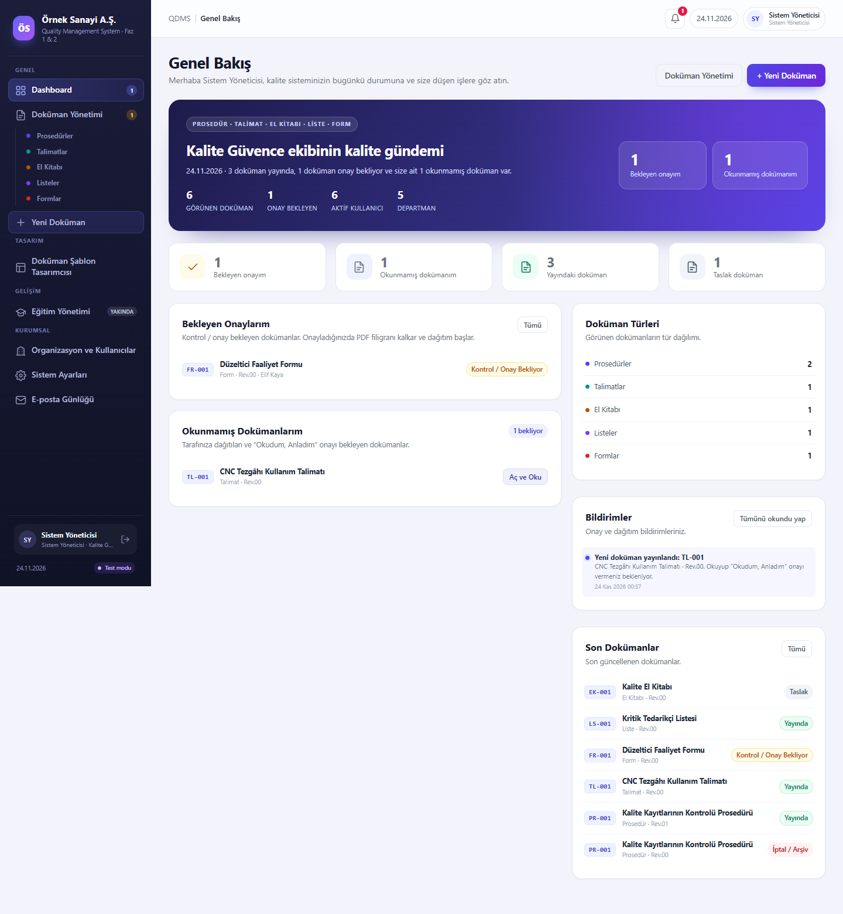
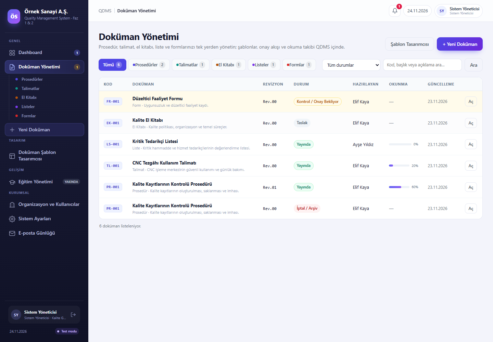
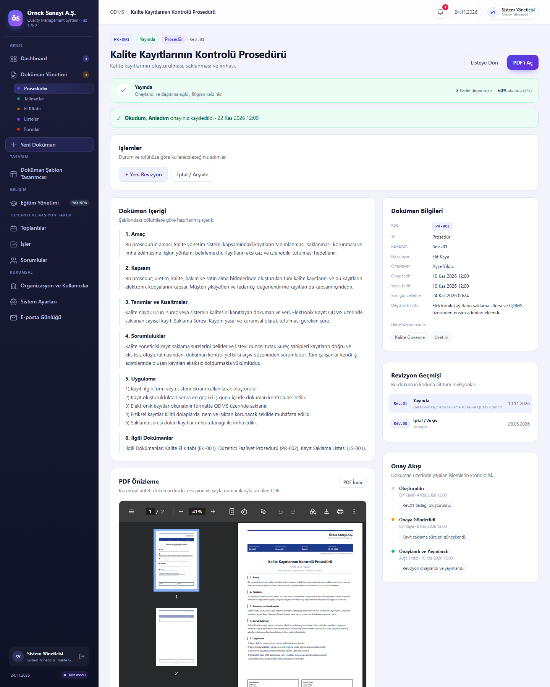
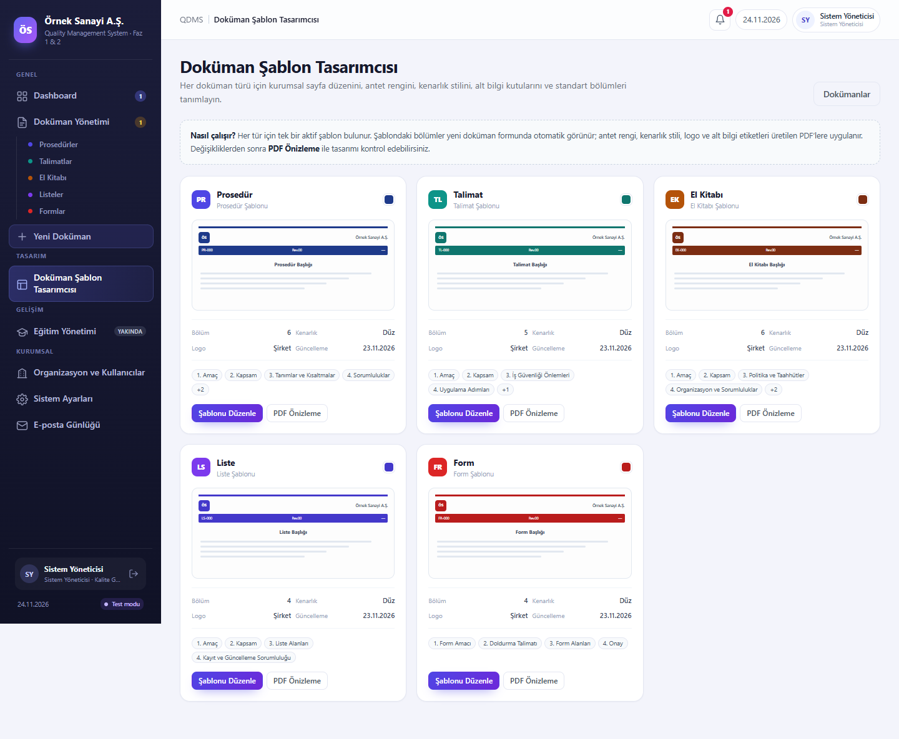
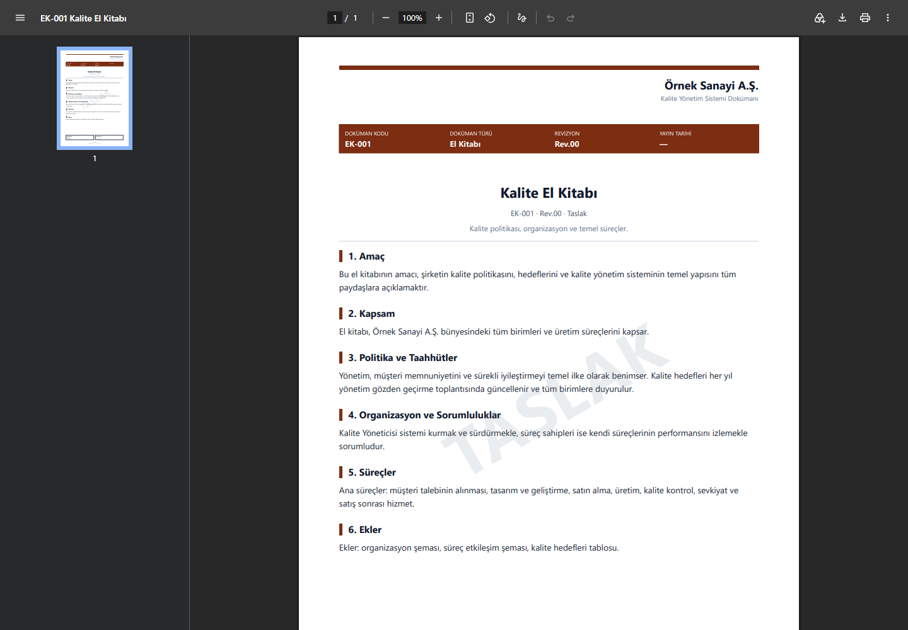
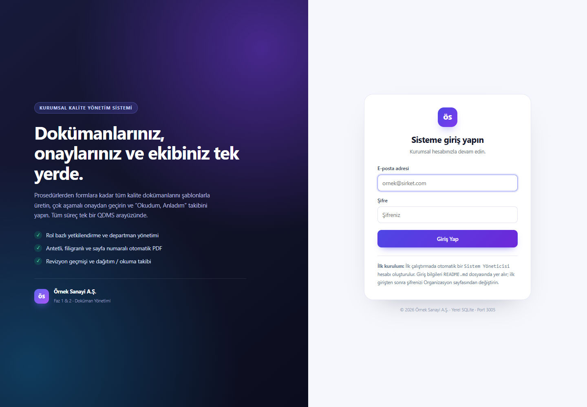
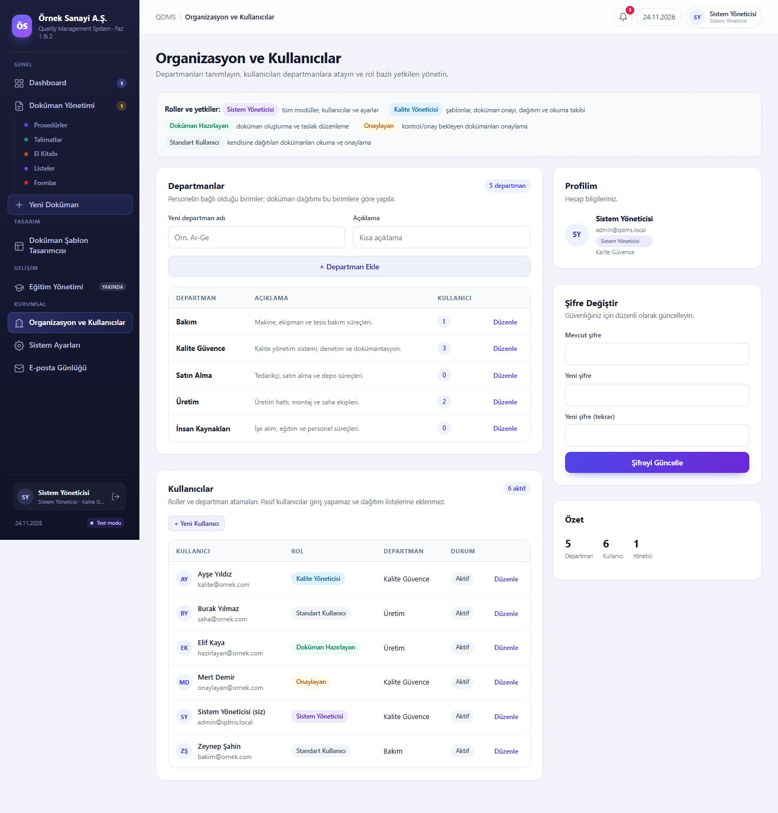
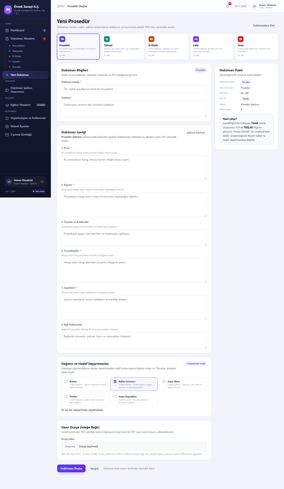

# QDMS — Kurumsal Kalite Yönetim Sistemi

Yerel bilgisayarda çalışan, SQLite üzerinde saklanan, Türkçe arayüzlü bir **Kalite Yönetim Sistemi (QDMS)**. Kullanıcı ve rol yönetimi, departmanlar, doküman şablonları, otomatik antetli PDF üretimi, çok aşamalı onay, revizyon geçmişi ve **“Okudum, Anladım”** takibi Faz 1 & 2 kapsamında hazırdır. Uygulama yalnızca Dashboard ve Doküman Yönetimi odaklı QDMS arayüzü sunar; eski **Toplantı ve Aksiyon Takibi** modülü kaldırılmıştır.

## Öne Çıkanlar

- **Kurumsal sol menü:** Dashboard, Doküman Yönetimi (Prosedür `PR`, Talimat `TL`, El Kitabı `EK`, Liste `LS`, Form `FR`), Doküman Şablon Tasarımcısı, Eğitim Yönetimi (yer tutucu), Organizasyon ve Kullanıcılar, Sistem Ayarları.
- **Giriş ve rol bazlı yetkilendirme:** Sistem Yöneticisi, Kalite Yöneticisi, Doküman Hazırlayan, Onaylayan, Standart Kullanıcı. İlk kurulumda otomatik yönetici hesabı oluşturulur.
- **Departman yönetimi:** Üretim, Kalite Güvence, İnsan Kaynakları, Bakım, Satın Alma hazır gelir; yeni birim eklenebilir, kullanıcılar departmanlara atanır.
- **Şablon tasarımcısı:** Her doküman türü için bölüm başlıkları, açıklamalar, zorunluluk, antet rengi, kenarlık stili, logo ve hazırlayan/onaylayan alt bilgi etiketleri tanımlanır. PDF önizlemesi anında alınır.
- **Otomatik kod ve PDF:** `PR-001`, `TL-001`, `EK-001`, `LS-001`, `FR-001` kodları otomatik atanır. Kurumsal antet, doküman kodu, yayın tarihi, `Rev.00`, `Sayfa 1/X`, hazırlayan/onaylayan kutuları ve Türkçe karakter desteğiyle PDF üretilir.
- **Onay ve revizyon:** `Taslak` → `Kontrol / Onay Bekliyor` → `Yayında` → `İptal / Arşiv`. Taslak PDF’inde **TASLAK** filigranı vardır; onaylandığında filigran kalkar, onaylayan ve onay tarihi belgeye işlenir. Yeni revizyon eski revizyonu arşivler; değişiklik notları saklanır.
- **Dağıtım ve okuma takibi:** Doküman yayınlandığında seçilen departman personeline bildirim düşer; personel “Okudum, Anladım” onayı verir. Kalite yöneticisi yüzdelik ve isim listesiyle takip eder.
- **İsteğe bağlı hazır dosya:** Sistem PDF’i üretmek yerine PDF/Excel dosyası yüklenebilir.
- **Sade QDMS arayüzü:** Sol menü ve Dashboard yalnızca kalite/doküman süreçlerine odaklanır.
- **Varsayılan port:** `3005` (`PORT` ortam değişkeniyle değiştirilebilir). Tüm tablolar SQLite’tadır.

## Ekran Görüntüleri

| Dashboard | Doküman Yönetimi |
| --- | --- |
|  |  |

| Doküman Detayı | Şablon Tasarımcısı |
| --- | --- |
|  |  |

| Taslak PDF (TASLAK filigranı) | Giriş Ekranı |
| --- | --- |
|  |  |

| Organizasyon ve Kullanıcılar | Yeni Doküman |
| --- | --- |
|  |  |

## Teknolojiler

| Katman | Teknoloji |
| --- | --- |
| Sunucu | Node.js, Express 5 |
| Arayüz | EJS sunucu taraflı şablonlar, saf CSS/JS |
| Veritabanı | SQLite (`node:sqlite`, ek native derleme gerekmez) |
| PDF | PDFKit (Unicode TTF gömme, filigran, sayfa numarası) |
| Dosya yükleme | Multer (logo, PDF/Excel) |
| E-posta | Nodemailer |
| Test | Node.js yerleşik `node:test`, HTTP üzerinden uçtan uca akışlar |

## Gereksinimler

- **Node.js 24 veya üzeri** (Node 26 ile test edildi)
- npm
- PDF’lerde Türkçe karakterler için işletim sisteminde bir Unicode yazı tipi (Windows’ta Segoe UI/Arial, Linux’ta DejaVu Sans, macOS’ta Arial otomatik aranır). İsterseniz `PDF_FONT_YOLU` ve `PDF_FONT_KALIN_YOLU` ile kendi TTF dosyalarınızı gösterebilirsiniz.
- E-posta göndermek için SMTP hesabı. Test modunda SMTP gerekmez.

## Kurulum

```bash
git clone https://github.com/emr3ks/toplanti-takip.git
cd toplanti-takip
npm install
```

Windows CMD/PowerShell:

```powershell
copy .env.example .env
```

macOS/Linux:

```bash
cp .env.example .env
```

Uygulamayı başlatın:

```bash
npm start
```

Tarayıcıda **http://127.0.0.1:3005** adresini açın. Farklı bir port için `.env` içinde `PORT=3006` gibi bir değer verin.

### İlk Giriş (Varsayılan Yönetici)

İlk çalıştırmada veritabanı boşsa otomatik olarak bir **Sistem Yöneticisi** hesabı oluşturulur:

| Rol | E-posta | Şifre |
| --- | --- | --- |
| Sistem Yöneticisi | `admin@qdms.local` | `Admin123!` |

> İlk girişten sonra **Organizasyon ve Kullanıcılar → Şifre Değiştir** bölümünden şifreyi değiştirin. Bu bilgiler yalnızca ilk kurulum içindir; üretim ortamında mutlaka değiştirilmelidir.

## Roller ve Yetkiler

| Rol | Yetkiler |
| --- | --- |
| **Sistem Yöneticisi** (`admin`) | Tüm modüller, kullanıcı/departman yönetimi, şirket ve SMTP ayarları, onay ve arşivleme |
| **Kalite Yöneticisi** (`kalite`) | Şablon tasarımı, doküman oluşturma/düzenleme, onaylama, dağıtım ve okuma takibi |
| **Doküman Hazırlayan** (`hazirlayan`) | Doküman oluşturma, kendi taslaklarını düzenleme ve onaya gönderme |
| **Onaylayan** (`onaylayan`) | Kontrol / onay bekleyen dokümanları onaylama veya iade etme |
| **Standart Kullanıcı** (`kullanici`) | Kendisine dağıtılan yayınlanmış dokümanları okuma ve “Okudum, Anladım” onayı verme |

Yetkisiz sayfalara erişim `403`, oturum yoksa giriş ekranına yönlendirme ile korunur. Tüm POST işlemleri oturum gerektirir.

## Modüller

### 1. Dashboard

- Bekleyen onaylar (onaylama yetkisi olanlara), okunmamış dokümanlar, yayındaki ve taslak doküman sayıları.
- Bildirimler, doküman tür dağılımı ve son dokümanlar.
- Bildirimler tek tıkla okundu işaretlenebilir.

### 2. Doküman Yönetimi

- Tür sekmeleri ve durum filtresiyle listeleme, kod/başlık/açıklama araması.
- Her doküman için revizyon, durum, hazırlayan ve okunma yüzdesi görünür.
- Standart kullanıcı yalnızca kendisine dağıtılan yayınlanmış dokümanları görür; taslaklar hazırlayan ve kalite ekibiyle sınırlıdır.

### 3. Doküman Şablon Tasarımcısı

- Her tür için ayrı şablon: şablon adı, antet/tablo rengi, kenarlık stili (düz/kesikli/çift), şablona özel logo, alt bilgi etiketleri.
- Bölüm düzenleyici: başlık, kullanıcıya gösterilen ipucu ve zorunlu/isteğe bağlı seçimi.
- PDF önizleme, tasarımı kaydetmeden önce görsel doğrulama sağlar.
- Logo yüklenmezse **Sistem Ayarları**’ndaki şirket logosu, o da yoksa şirket baş harfleri kullanılır.

### 4. Doküman Oluşturma ve PDF

1. Doküman türü seçilir; sıradaki kod otomatik hesaplanır (`PR-001`, `PR-002`, …).
2. Şablon bölümleri form alanları olarak gelir; zorunlu bölümler boş bırakılamaz.
3. Hedef departmanlar seçilir (en az bir zorunlu).
4. “Dokümanı Oluştur” ile **Taslak** kaydı oluşur.
5. `PDF’i Aç` / `PDF İndir` bağlantısı belgeyi üretir. PDF’de:
   - şirket adı ve logo,
   - doküman kodu, türü, revizyonu ve yayın tarihi tablosu,
   - başlık ve bölüm içerikleri,
   - hazırlayan ve onaylayan alt bilgi kutuları,
   - `Sayfa 1/X` numarası,
   - taslak durumunda çapraz **TASLAK** filigranı bulunur.
6. İsteğe bağlı olarak hazır PDF/Excel dosyası yüklenebilir (en fazla 10 MB). Bu durumda hazır dosya indirilebilir; sistem PDF’i yerine yüklenen dosya kullanılır.

### 5. Onay Akışı ve Revizyon Yönetimi

| Durum | Açıklama |
| --- | --- |
| `Taslak` | Hazırlanıyor; yalnızca hazırlayan ve kalite ekibi görür. PDF’de `TASLAK` filigranı vardır. |
| `Kontrol / Onay Bekliyor` | Onaya gönderildi; onaylayanlar inceler. |
| `Yayında` | Onaylandı; filigran kalkar, onaylayan/tarih PDF antetine işlenir, dağıtım başlar. |
| `İptal / Arşiv` | Yürürlükten kaldırıldı veya yeni revizyonla arşivlendi. Geçmiş korunur. |

- **Onaya Gönder:** Hazırlayan veya kalite ekibi, hedef departman ve içerik kontrolünden sonra gönderir; onaylayanlara bildirim gider.
- **Onayla ve Yayınla:** Onaylayan/kalite yöneticisi/yönetici yapar. Onaylayan ve onay tarihi kaydedilir, hedef departman personeline okuma bildirimi oluşturulur.
- **Reddet / İade Et:** Gerekçe zorunludur; doküman taslağa döner, hazırlayana bildirim gider.
- **Yeni Revizyon:** Yayındaki veya arşivdeki en güncel revizyon için değişiklik notuyla açılır. Önceki revizyon otomatik `İptal / Arşiv` olur; tüm revizyonlar ve notlar saklanır.
- **İptal / Arşivle:** Yetkili kullanıcı dokümanı yürürlükten kaldırır.

### 6. Dağıtım ve “Okudum, Anladım” Takibi

- Yayınlama anında hedef departmanların aktif kullanıcıları için okuma kaydı ve bildirim oluşturulur.
- Standart kullanıcı doküman detayında **“✓ Okudum, Anladım”** butonunu görür; onay zamanı kaydedilir.
- Kalite yöneticisi/yönetici, detay sayfasında okunma yüzdesini ve personel bazında okudu/bekliyor listesini görür.
- Yeni revizyon yayınlandığında okuma takibi yeni revizyon için yeniden başlar.

### 7. Eğitim Yönetimi

Faz 1 kapsamında **yer tutucu** menüdür; eğitim kataloğu, atama ve yeterlilik takibi sonraki faza bırakılmıştır.

### 8. Organizasyon ve Kullanıcılar

- Sistem Yöneticisi yeni departman açar/düzenler/siler (kullanıcı atanmış departman silinemez).
- Kullanıcı oluşturma, rol ve departman atama, hesabı aktif/pasif yapma, şifre belirleme.
- Her kullanıcı kendi şifresini değiştirebilir. Sistemde en az bir aktif yönetici kalması korunur.

### 9. Sistem Ayarları

- **Şirket Kimliği:** Şirket adı ve logosu; PDF antetlerinde kullanılır.
- **SMTP:** Sunucu, port, SSL/TLS, kullanıcı, şifre, gönderen adı/e-postası. Gmail için uygulama şifresi gerekir.
- **Görünüm ve Test:** Saat dilimi ve e-posta test modu.
- **Test araçları:** SMTP bağlantı testi ve test e-postası.
- Varsayılan sunucu portu `3005`’tir.

## PDF Tasarımı

- A4 dikey sayfa, kurumsal antet bandı ve dört hücreli doküman bilgi tablosu (kod, tür, revizyon, yayın tarihi).
- Bölüm başlıkları renkli işaretle, gövde metni satır sonu ve paragrafları koruyarak yazılır.
- Alt bilgide hazırlayan ve onaylayan kutuları; onay öncesi “Onay bekliyor”, yayında onay tarihi görünür.
- Her sayfada `Sayfa X/Y` ve doküman kodu.
- Taslakta her sayfada açılı **TASLAK** filigranı.
- Türkçe karakterler için Unicode TTF gömülür; font bulunamazsa güvenli bir yedek yazı tipi ve Türkçe karakter dönüşümü kullanılır.

## Demo Verisi

Ekran görüntülerindeki gibi örnek verilerle denemek için:

```bash
npm run demo
npm start
```

Mevcut demo verilerini silip yeniden oluşturmak için:

```bash
npm run demo -- --sifirla
```

Demo komutu; örnek kullanıcıları, departman atamalarını, şablon kontrollü dokümanları, revizyonları, onay bekleyen kayıtları ve okuma durumlarını oluşturur. E-posta ayarları **test modunda** kaydedilir; gerçek e-posta gönderilmez.

### Demo Giriş Bilgileri

| Rol | E-posta | Şifre |
| --- | --- | --- |
| Sistem Yöneticisi | `admin@qdms.local` | `Admin123!` |
| Kalite Yöneticisi | `kalite@ornek.com` | `Kalite123!` |
| Doküman Hazırlayan | `hazirlayan@ornek.com` | `Hazirlayan123!` |
| Onaylayan | `onaylayan@ornek.com` | `Onaylayan123!` |
| Standart Kullanıcı (Üretim) | `saha@ornek.com` | `Standart123!` |
| Standart Kullanıcı (Bakım) | `bakim@ornek.com` | `Standart123!` |

> Demo şifreleri yalnızca yerel deneme içindir.

## Testler

```bash
npm test
```

Testler şunları kapsar:

- Giriş, oturum, varsayılan yönetici, rol bazlı yetkilendirme ve şifre değişimi
- Departman/kullanıcı oluşturma, yönetim ekranlarının yetki koruması
- Doküman oluşturma, otomatik kodlama ve zorunlu alan doğrulaması
- Taslak/onaylı PDF üretimi, Türkçe karakterler ve taslak-yayın farkı
- Onaya gönderme, onaylama, iade ve arşivleme
- Yeni revizyon oluşturma, eski revizyonun arşivlenmesi ve değişiklik notu
- Dağıtım, “Okudum, Anladım”, yüzdelik takip ve erişim sınırları
- Şablon ve logo kaydetme, PDF önizleme, şirket kimliği
- Hazır PDF yükleme/indirme
- SMTP bağlantısı, e-posta günlüğü ve ayar yönetimi
- Kaldırılan toplantı/aksiyon sayfalarının artık 404 döndürmesi ve menüde görünmemesi

## Proje Yapısı

```text
.
├── server.js                 # Uygulama giriş noktası (varsayılan port 3005)
├── src/
│   ├── app.js                # Express rotaları: QDMS arayüzü
│   ├── auth.js               # Şifre (scrypt), oturum, roller ve yetkiler
│   ├── qdms.js               # Doküman türleri, durumlar, şablon/kod yardımcıları
│   ├── varsayilanlar.js      # İlk kurulum seed: departman, tür, şablon, admin
│   ├── pdf.js                # PDFKit ile antetli/filigranlı PDF üretimi
│   ├── db.js                 # SQLite şeması ve bağlantı
│   ├── config.js             # .env ve yapılandırma
│   ├── dates.js              # Tarih/saat/saat dilimi yardımcıları
│   ├── dogrulama.js          # Form ve e-posta doğrulama
│   ├── emails.js             # HTML e-posta şablonları
│   ├── mailer.js             # Nodemailer + test modu outbox
│   ├── settings.js           # Ayar okuma/yazma, şirket kimliği
│   └── sabitler.js           # E-posta durum ve tür etiketleri
├── views/                    # EJS sayfaları ve partial'lar
├── public/                   # CSS, JS, favicon
├── scripts/demo-verisi.js    # Örnek QDMS verisi
├── test/                     # node:test testleri
├── docs/screenshots/         # Ekran görüntüleri
├── data/                     # SQLite, outbox ve yüklemeler (gitignore)
└── .github/workflows/test.yml
```

## Veritabanı Şeması (Özet)

- `kullanicilar`: `id`, `ad`, `email`, `sifre_hash` (scrypt), `rol`, `departman_id`, `aktif`
- `departmanlar`: `id`, `ad`, `aciklama`
- `oturumlar`: `token`, `kullanici_id`, `son_gecerlilik`
- `dokuman_turleri`: `kod` (`PR`, `TL`, `EK`, `LS`, `FR`), `ad`, `sira`
- `sablonlar`: `tur_kod`, `baslik`, `bolumler` (JSON), `antet_renk`, `kenarlik_stili`, `logo_yolu`, `altbilgi_hazirlayan`, `altbilgi_onaylayan`
- `dokumanlar`: `kod`, `tur_kod`, `baslik`, `revizyon`, `durum`, `icerik` (JSON bölümler), `degisiklik_notu`, `hazirlayan_id`, `onaylayan_id`, `onay_tarihi`, `yayin_tarihi`, `dosya_yolu`
- `dokuman_hedef_departmanlar`: doküman ↔ departman dağıtım hedefi
- `dokuman_okumalari`: `dokuman_id`, `kullanici_id`, `okundu`, `okunma_tarihi`
- `dokuman_onaylari`: doküman üzerindeki işlem geçmişi (`olustur`, `onaya_gonder`, `onayla`, `reddet`, `arsivle`, `revizyon`)
- `bildirimler`: kullanıcıya özel onay/doküman bildirimleri
- `ayarlar`, `email_kayitlari`: sistem ayarları ve e-posta günlüğü

Doküman kodları `(kod, revizyon)` çiftinde benzersizdir; aynı kodun farklı revizyonları geçmiş olarak saklanır. Yabancı anahtarlar açıktır (`PRAGMA foreign_keys = ON`).

## Ortam Değişkenleri

| Değişken | Varsayılan | Açıklama |
| --- | --- | --- |
| `PORT` | `3005` | HTTP portu |
| `HOST` | `127.0.0.1` | Dinlenecek adres (yalnızca yerel kullanım için değiştirmeyin) |
| `DATA_DIR` | `./data` | Veri klasörü |
| `DB_YOLU` | `./data/toplanti.db` | SQLite veritabanı yolu |
| `OUTBOX_DIR` | `./data/outbox` | Test modu e-posta çıktı klasörü |
| `SMTP_HOST` | boş | SMTP sunucusu |
| `SMTP_PORT` | `587` | SMTP portu |
| `SMTP_SECURE` | `false` | `true` ise SSL/TLS (genellikle 465) |
| `SMTP_USER` | boş | SMTP kullanıcısı |
| `SMTP_PASS` | boş | SMTP şifresi / uygulama şifresi |
| `SMTP_FROM_EMAIL` | boş | Gönderen adresi |
| `SMTP_FROM_NAME` | `Kurumsal Kalite Yönetim Sistemi` | Gönderen adı |
| `SAAT_DILIMI` | `Europe/Istanbul` | Tarih/saat gösterimi için IANA saat dilimi |
| `MAIL_TEST_MODE` | boş | `1` ise e-postalar gönderilmez, outbox’a yazılır |
| `PDF_FONT_YOLU` | boş | PDF için isteğe bağlı normal TTF yolu |
| `PDF_FONT_KALIN_YOLU` | boş | PDF için isteğe bağlı kalın TTF yolu |

Arayüzden kaydedilen değerler `.env` değerlerini geçersiz kılar. SMTP şifresi boş bırakılırsa mevcut şifre korunur.

## Güvenlik Notları

- İlk kurulum yönetici şifresi `README.md`’de açıkça yer alır; **ilk girişte değiştirilmelidir**.
- Parolalar `scrypt` ile tuzlanmış olarak saklanır. Oturumlar `HttpOnly`, `SameSite=Lax` çerezle ve sunucu tarafındaki rastgele token ile yönetilir; süre 7 gündür.
- Uygulama varsayılan olarak yalnızca `127.0.0.1` üzerinde dinler. İnternete açık bir sunucuya taşınacaksa HTTPS, ters vekil (reverse proxy), güvenlik duvarı ve istek sınırlandırma eklenmelidir.
- Yüklenen logolar PNG/JPG/WEBP ile, belgeler PDF/XLS/XLSX ile ve 10 MB sınırıyla kısıtlanır; dosyalar yalnızca oturum açmış kullanıcılara sunulur.
- Formlarda CSRF token’ı ve giriş denemesi sınırlandırması yoktur; yerel/kurum içi kullanım için tasarlanmıştır.
- SMTP şifresi SQLite’ta düz metin olarak saklanır. `data/` klasörünü ve `.env` dosyasını koruyun; depoya eklemeyin.

## Sınırlamalar

- Uygulama tek sunucu/tek veritabanı için tasarlanmıştır; çok kiracılı (multi-tenant) değildir.
- Yüklenen hazır PDF’lerin üzerine **TASLAK** filigranı eklenmez; filigran yalnızca sistem tarafından üretilen PDF’lerde uygulanır. Excel dosyaları tarayıcıda önizlenemez.
- PDF üretimi işletim sistemindeki Unicode yazı tipine bağlıdır. Hiçbir TTF bulunamazsa Türkçe karakterler ASCII karşılıklarıyla yazılır (`PDF_FONT_YOLU` ile giderilebilir).
- Eğitim Yönetimi modülü henüz yer tutucudur.
- E-posta teslimi SMTP sağlayıcısına bağlıdır.
- E-posta ekleri ve takvim (iCal) entegrasyonu yoktur.

## Sorun Giderme

| Sorun | Çözüm |
| --- | --- |
| `Cannot find module 'node:sqlite'` | Node.js sürümünüzü 24+ yapın. |
| `EADDRINUSE` | Port kullanımda; `.env` içinde `PORT=3006` gibi başka bir port seçin. |
| Giriş yapılamıyor | Varsayılan yönetici bilgileriyle (`admin@qdms.local` / `Admin123!`) deneyin; şifre değiştirildiyse yöneticinizden sıfırlamasını isteyin. |
| PDF’de Türkçe karakter bozuk | `PDF_FONT_YOLU` ile Unicode bir TTF dosyası gösterin (örn. Segoe UI veya DejaVu Sans). |
| Logo görünmüyor | PNG/JPG/WEBP formatında ve 10 MB altında olduğundan emin olun; şablona özel logo yoksa şirket logosu kullanılır. |
| SMTP bağlantısı kurulamıyor | Sunucu/port değerlerini, Gmail için uygulama şifresini ve 2FA’yı kontrol edin. |
| Tarih alanı `mm/dd/yyyy` gösteriyor | Tarayıcı yerel ayarıdır; uygulama tarihleri `gg.aa.yyyy` olarak gösterir. |

## Lisans

MIT
